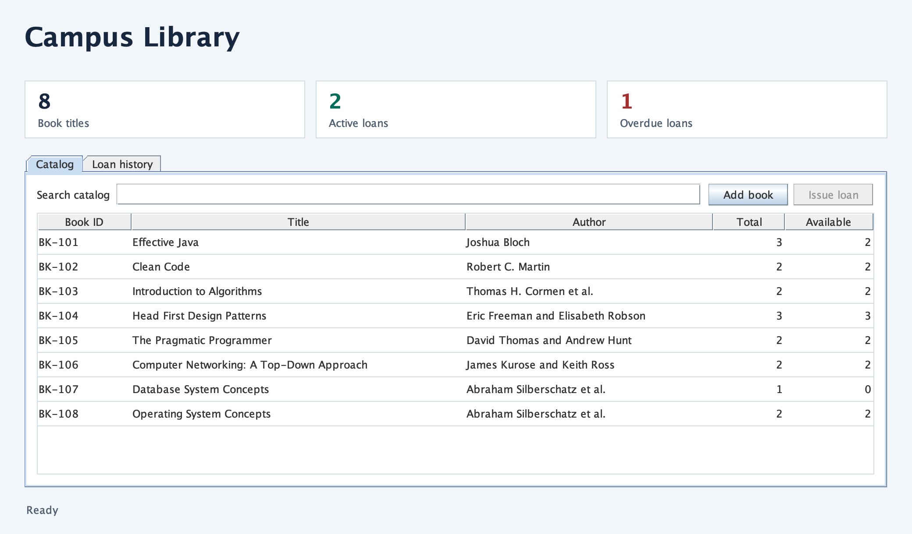
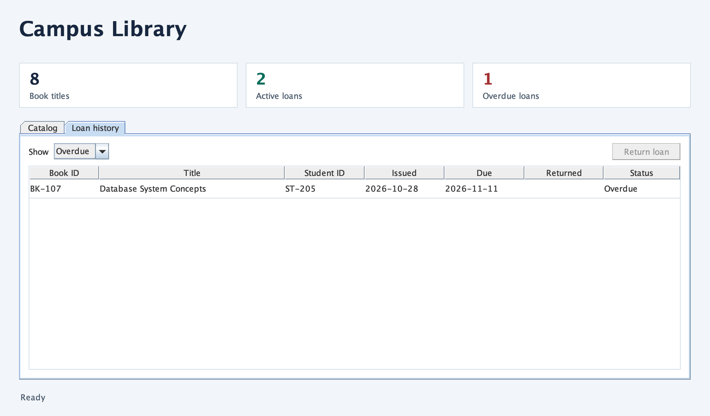

# Campus Library project report

## Abstract

Campus Library is a Java desktop application for a librarian managing a college book collection. It tracks the number of available copies, records which students borrowed books, and retains returned loans for later review. The application uses Java Swing and stores its catalog and lending history in a local, tab-separated text file.

## Objectives

- Search the catalog by book ID, title, or author.
- Add books with unique IDs and positive copy counts.
- Issue and return copies while maintaining accurate availability.
- Display active, overdue, and returned loans.
- Keep records after the application closes.

## System design

| Class | Responsibility |
| --- | --- |
| `CampusLibrary` | Builds the catalog and loan history screens, handles user actions, and refreshes the tables. |
| `Library` | Holds the catalog and history, checks lending rules, and creates updated snapshots. |
| `LibraryFile` | Parses, validates, and saves snapshots in `data/library.tsv`. |
| `SubmissionCheck` | Exercises the main features and checks whether saved records load in a fresh Java process. |

A book record stores its ID, title, author, and total copy count. A loan record stores its ID, the related book ID, the student ID, and issue, due, and return dates. Each file starts with `CAMPUS_LIBRARY_V1` and has one `BOOK` or `LOAN` record per line. A blank return date marks an active loan.

## Lending workflow

To issue a book, the app checks that the book exists, a copy is available, and the student has no active loan for that title. It sets the due date 14 days after the issue date. Whenever the app displays the catalog, it calculates availability by subtracting active loans from the book's total copies. Returning a book records the return date and leaves its loan in the history.

## Storage and scope

The app writes an updated snapshot to a temporary file before replacing the saved file. It uses an atomic move when supported by the filesystem and holds a file lock throughout the session to prevent a second writer. The app is designed for one local librarian and one branch.

## Interface previews

These images were rendered from the Java Swing panels using the sample data.

